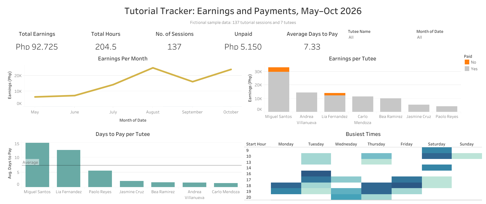
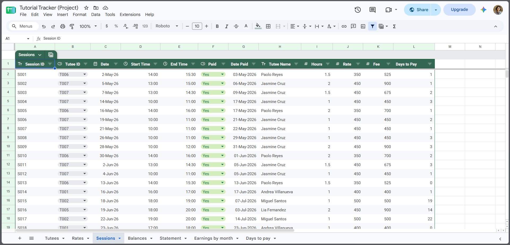
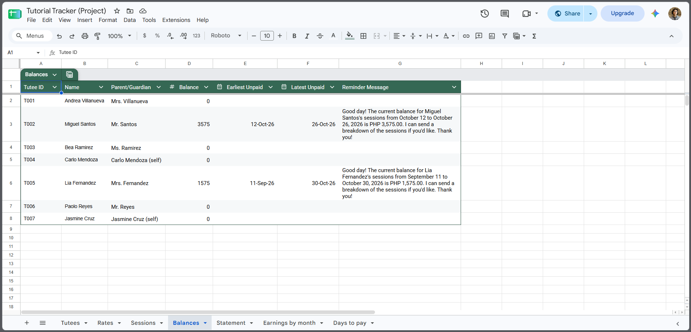
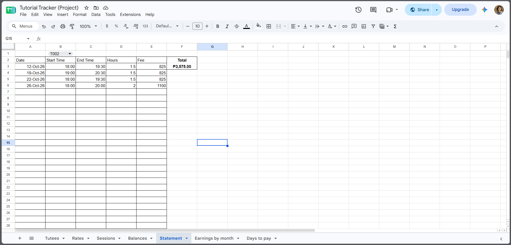

# Tutorial Tracker: Earnings and Payments Analysis

A payment tracker for private tutoring, built in **Google Sheets** and visualized in **Tableau**. It calculates fees from session times and a rate history, tracks unpaid balances, writes payment reminders, and shows earnings and payment patterns on an interactive dashboard.

🔗 **[Interactive dashboard (Tableau Public)](https://public.tableau.com/app/profile/marvic.kaizz.sobrevi.as/viz/TutorialTracker/TutorialTrackerEarningsandPaymentsMayOct2026)**
🔗 **[Live spreadsheet (Google Sheets, view only)](https://docs.google.com/spreadsheets/d/1YoltnZhgTLZWxXzjNFrDjriGGKYFr0Jatt-nSDT1sRc)**



> **Note:** all names and records are fictional sample data (137 sessions, 7 tutees, May–October 2026).

---

## The problem

I was blessed with so many clients (whom I lovingly call tutees) that keeping track of everything by myself became difficult. These were some issues I had:

- **I had to remember each tutee’s rate,** or dig through old conversations to find it, and calculate hours and fees by hand.
- **Finding who owed what took manual scrolling.**
- **I couldn't easily see patterns,** like my busiest months and hours, or which families usually pay late.

## The solution

### 1. Data model

In the past, I recorded everything manually in one table. After studying some data analysis techniques, especially data modeling, I split it into the three tables below::

| Table | Columns | Purpose |
|---|---|---|
| `tutees` | Tutee ID, Tutee Name, Parent/Guardian, Subject | One row per tutee |
| `rates` | Tutee ID, Effective From, Rate (PHP/hr) | Rate history: a new row whenever a rate changes |
| `sessions` | Session ID, Tutee ID, Date, Start Time, End Time, Paid, Date Paid, plus calculated columns | One row per session |

Keeping rates in their own table means a rate change never rewrites history.


*The `sessions` table: the data I enter (date, times, paid status) plus calculated columns for hours, rate, fee and days to pay.*

### 2. Calculations (Google Sheets)

In the past, I had to type each tutee’s rate by hand, either from memory or by searching through our old conversations. Other than that, I also calculated the hours, the fee for each session, and how long each tutee took to pay, all by hand. So I applied what I learned in my data analysis journey and wrote these calculations: 

- **Hours:** from start and end times: `(End − Start) × 24`
- **Rate on the session date:** the latest rate that took effect on or before that day:
  ```
  =XLOOKUP(1, (rates!A:A = B2) * (rates!B:B <= C2), rates!C:C, "", 0, -1)
  ```
  The two conditions are multiplied, so only rows that match the tutee **and** started on or before the session date return 1. Search mode `-1` searches from the bottom, so it returns the most recent of those rates.
- **Fee:** Hours × Rate
- **Days to pay:** Date Paid − Session Date

### 3. Outputs (Google Sheets)

Before this, I had to type out every balance reminder to parents and guardians by hand. Now Google Sheets formulas generate the message for me, ready to send.

- **`balances`:**
  - Each tutee's unpaid balance (`SUMIFS`)
  - The earliest and latest unpaid session dates (`MINIFS`, `MAXIFS`)
  - A ready-to-send **payment reminder message** built with `TEXT` and `&`, for example: *"Good day! The current balance for Miguel Santos's sessions from … to … is PHP 3,575.00…"*


*Each tutee's unpaid balance, the dates of their unpaid sessions, and a ready-to-send reminder message.*

- **`statement`:** pick a Tutee ID and `FILTER` lists only that family's unpaid sessions, with a total. Useful as a breakdown to send to parents.
- **Pivot tables:** fees by tutee and month, and average days to pay by tutee.


*Select a Tutee ID in the top cell and the statement lists only that family's unpaid sessions, with a total.*

### 4. Dashboard (Tableau Public)

Finally, I built a dashboard to practice data visualization and to see how my tutoring is going at a glance.

- **KPI cards:** total earnings, hours, sessions, unpaid balance, average days to pay
- **Earnings per month**
- **Earnings per tutee,** with unpaid fees highlighted
- **Days to pay per tutee,** against the overall average
- **Busiest times:** a weekday × start-hour heatmap
- **Filters:** tutee and month. Clicking a tutee's bar filters the whole dashboard.

## Key findings (all tutees, May–Oct 2026)

- **₱92,725 earned** over 137 sessions (204.5 hours). Earnings **peaked in August**.
- **Two tutees take 12–15 days to pay** against a 7.3-day average, and together they hold **all ₱5,150** of the unpaid balance. Everyone else pays within about 1–5 days.
- **Most sessions are on weekday evenings (around 6–7 pm) and Saturday mornings.**

**What I'd do with this:**
- Send reminders sooner to the two slow-paying families, using the generated messages.
- Keep weekday evenings and Saturday mornings open for new tutees, since that's when demand is.

## Challenges and what I learned

- **Rate history:** a plain lookup returned the *current* rate for every session. I switched to a two-condition XLOOKUP that returns the rate in effect on each session's date.
- **Checking numbers against the source:** my first "Unpaid" card showed the same value as total earnings. A filter wasn't applied to that sheet, and I caught it by comparing the dashboard with the spreadsheet.
- **Continuous vs. discrete fields in Tableau:** the start hour had to be discrete to build the heatmap.
- **Titles and filters:** chart titles that state a finding become false once someone filters the dashboard. I kept chart titles neutral and put the findings here instead.

## Tools

Google Sheets (XLOOKUP, SUMIFS, MINIFS, MAXIFS, FILTER, TEXT, pivot tables) · Tableau Public (calculated fields, reference lines, dashboard actions)

## Files

```
tutorial-tracker/
├── README.md
├── data/
│   ├── tutees.csv
│   ├── rates.csv
│   └── sessions.csv
└── images/
    ├── dashboard.png
    ├── sessions-sheet.png
    ├── balances-sheet.png
    └── statement-sheet.png
```

## Author

**Marvic Kaizz D.J. Sobreviñas** · Data analyst (career shifter from science teaching)
[LinkedIn](https://www.linkedin.com/in/naisukaizu/) · marvic.kaizz@gmail.com
